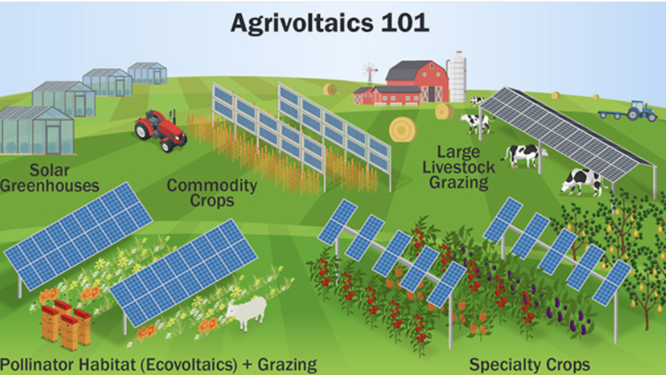

# Agrivoltaics Project

## Motivation

Agrivoltaics is the process of combining agriculture and photovoltaics.
This has a number of advantages over limiting land use to either agriculture or photovoltaics.

- Energy production due to solar panels
- Agricultural production
- Increased land use
- Less irrigation due to less evaporation
- Protection from extreme heat
- Possible IoT base stations to monitor weather, soil, crop quality
- Possible protection from hail

This process is becoming more and more important due to a number of reasons:

- Higher temperatures leading to more evaporation
- More extreme weather events such as hailstorms
- Cheap and reliable solar panels
- High energy demand and prices, leading to opportunities for farmers with high energy need
- Diversification for farms with higher protection from harvest misses

## Project: Agrivoltaic Potential Calculator — Web Application

The project consists of a website with different functionality.

# Data maps

The data maps show climatic and agricultural data for Austria.
This includes GHI, temperatures, crop distribution in the different states, and further.

# Agrivoltaics calculator

This is the heart of the application, and is meant as a base for farmers to find out if a solar system is interesting and feasible for them.
The workflow is described below in more detail. Detailed calculations and financial numbers can help drive interest.

# Sources and further information

The sources section entails all the sources used for this project, and can help as a base for further information.

### User Input Flow Calculator

**Step 1 — Location**
- Click on a map of Austria (Leaflet.js) or enter address/postal code
- App auto-fills: GHI (kWh/m²/yr), average temperature, annual precipitation, hail risk index

**Step 2 — Farm Details**
- Total area (ha)
- Crop type (dropdown with Austrian staples: wheat, maize, potatoes, vegetables, grapes, berries, mixed)
- Current annual yield (t/ha) and market price (€/t) — pre-filled with Austrian averages from Agraratlas, editable
- Whether the farmer currently irrigates (yes/no, how much)

**Step 3 — System Configuration** *(optional, advanced)*
- Panel coverage ratio (default: 15–20% — the half-density standard)
- System size (kWp) or auto-calculated from area
- Electricity use: self-consumption vs. full feed-in

**Step 4 — Results Dashboard**
- Summary card: "Your land has **High / Medium / Low** agrivoltaic potential"
- Energy yield: X MWh/yr → €X/yr revenue
- LER score: gauge showing land efficiency gain
- Water savings: X m³/yr → €X saved in irrigation
- Crop yield impact: +/- X% by crop type
- Financial summary: annual net benefit (€), payback period (years), break-even tariff
- Hail/weather risk score: risk reduction value
- Downloadable PDF report

---

### Tech Stack

| Layer | Technology |
|---|---|
| Frontend | React + TypeScript |
| Styling | Tailwind CSS |
| Map | Leaflet.js + OpenStreetMap tiles |
| Charts | Recharts or Chart.js |
| Backend | Python (Flask or FastAPI) |
| Container | Docker |

---

### Data Sources to Integrate

| Dataset | Purpose | Source |
|---|---|---|
| GHI / solar irradiance | Energy yield calculation | Solar resource maps & GIS data SOLARGIS |
| Agricultural land parcels | Validate land is farmland | Agraratlas Austria / INVEKOS |
| Crop statistics Austria | Default yield/price per crop | Statistik Austria, AMA |
| Electricity tariffs Austria | Revenue calculation | E-Control Austria |

### What to improve

- Field testing: find out what farmers actually need, how much this can help them, which information is missing, and where to get it.
- Crop yield change data was not too abundant; further research is required here.
- Contact different solar park operators on cost and feasibility of such systems, build times, and other options.

This could be further explored in the context of a thesis.
