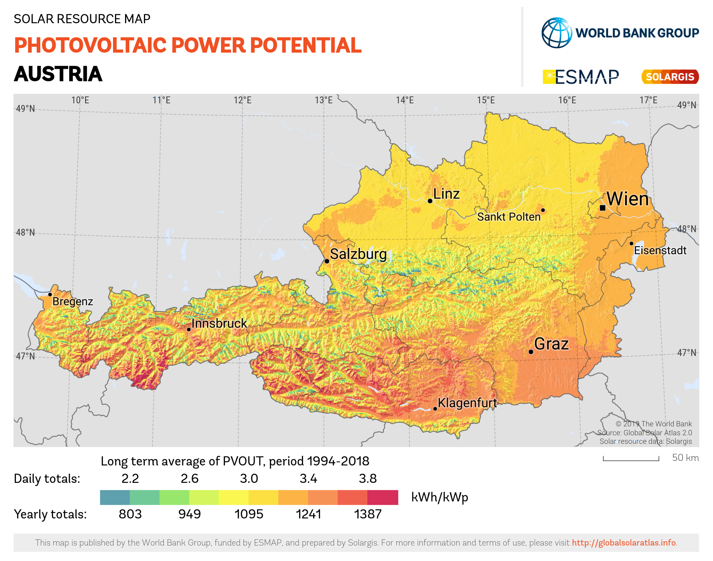

# Agripholtaics Project

## Motivation

Agripholtaics is the process of combining agriculture and photovoltaics. This has a number of advantages.


- Energy production due to solar panels
- Agricultural production
- Increased land use
- Less irrigation due to less evaporation
- Protection from extreme heat
- Possible IOT stations to monitor weather, soil, crop quality
- Possible protection from hail

## Project Idea
To find the agripholtaic potential for regions in Austria, different datasets will be gathered and combined into a scoring model:

- [x] Solar irradiance
- [x] Agricultural land use

These datasets will be overlaid on an interactive map. A user can select a region and receive an **agripholtaic value score** — a combined metric reflecting how beneficial agrivoltaics would be in that area (e.g. high solar yield + high heat stress on crops + hail risk = high value for installing panels).

It will also be necessary to research what crops are common in Austria and how much they benefit from agrivoltaic setups (shade tolerance, heat/hail protection, water retention), in order to weight the score correctly.

## First steps


- Collect Data on Agraratlas
- Collect Data on Solar Irradiance
- Analyze top agrar products for austria and their research with agripholtaics

---

## Project: Agrivoltaic Potential Calculator — Web Application

### Vision

A clean, farmer-facing web app where a landowner enters their location and farm details and receives a full agrivoltaic potential report: how much energy their land could generate, how much water they could save, how their crops would be affected, and whether the investment would be profitable. The calculations are grounded in peer-reviewed research (see References/studies/).

---

### Calculation Engine

The app translates results from four key papers into practical estimates:

#### 1. Solar Energy Yield
**Source:** Fraunhofer ISE Guideline (2024); Cuppari et al. (2021)

```
Annual PV yield (MWh) = GHI (kWh/m²/yr) × panel_area (m²) × η_panel × PR
```
- `η_panel` ≈ 0.20 (modern bifacial panels)
- `PR` (performance ratio) ≈ 0.80
- Rule of thumb: 1 ha of agrivoltaic installation ≈ 0.35 MWp ≈ 315–420 MWh/yr in Austria
- Annual revenue = Annual yield × electricity tariff (current AT grid tariff or feed-in rate)

#### 2. Land Use Efficiency — LER Score
**Source:** Elamri et al. (2018); Cuppari et al. (2021)

```
LER = (crop_yield_AV / crop_yield_control) + (PV_yield_AV / PV_yield_solo)
```
- LER > 1.0 means co-location is more land-efficient than separate uses
- Reported values: **LER 1.35–2.00** (35–100% more productive per hectare)
- Displayed as a gauge/score on the results page

#### 3. Water Savings
**Source:** Elamri et al., *Agricultural Water Management* (2018)

- Panels reduce incoming solar radiation by **20–50%** depending on configuration
- This cuts crop evapotranspiration, reducing irrigation demand by **20–30%**
- Model: shading_rate → stomatal conductance reduction → ΔET → Δirrigation (L/ha/yr)
- Displayed as: *"Your farm could save ~X m³ of irrigation water per year"*

#### 4. Financial Profitability — FEADPLUS Framework
**Source:** Feuerbacher et al., *Agricultural Systems* (2021)

Profitability condition (farmer adopts AV when this is > 0):
```
ΔE_Agri + E_PV > 0
```
Where:
- `ΔE_Agri` = change in agricultural contribution margin (can be negative due to shading)
- `E_PV` = annualized profit from electricity sold
- `ΔE_Agri` depends on: crop type, shading rate, yield factor (δ), cost increase factor (γ)
- Break-even electricity tariff reported: **8.63 ct/kWh** (cereals) — **9.00 ct/kWh** (vegetables)
- Agricultural contribution margin decline: ~40% for vegetable farms, ~73% for cereal farms (at standard shading) — partially offset by PV revenue

Output: annual net benefit (€), payback period (years), break-even tariff comparison to current market price

#### 5. Weather Risk Reduction
**Source:** Cuppari et al., *Applied Energy* (2021)

- Revenue increase vs. farm-only: **+300% to +5000%** depending on crop and location
- Worst-case revenue floor lifted by **48–53%** for high-risk crops (e.g. strawberries)
- Solar revenue is negatively correlated with crop revenue — good years for one offset bad years for the other
- Displayed as: risk diversification score + comparison to crop insurance cost

#### 6. Crop-Specific Shading Tolerance
**Source:** Widmer et al., *Renewable and Sustainable Energy Reviews* (2024)

| Crop type | Shade tolerance | Expected yield impact |
|---|---|---|
| Lettuce, spinach, herbs | High | 0% to +10% |
| Potatoes, blueberries | Medium-High | −5% to +5% |
| Wheat, barley | Medium | −10% to −20% |
| Maize (C4 plant) | Low | −20% to −40% |
| Strawberries, apples | Medium + hail benefit | Net positive possible |
| Grapes / vines | Medium | Site-dependent |

#### 7. Hail & Frost Protection Value
**Source:** Fraunhofer ISE Guideline (2024)

- Panels act as physical hail barrier — significant for fruit, berry, and vegetable crops
- Estimated value: annual hail insurance premium saved + historical hail loss avoided
- Input: crop type + regional hail frequency (from Austrian weather risk data)
- Output: *"Estimated annual protection value: ~€X/ha"*

---

### User Input Flow

**Step 1 — Location**
- Click on a map of Austria (Leaflet.js) or enter address/postal code
- App auto-fills: GHI (kWh/m²/yr), average temperature, annual precipitation, hail risk index

**Step 2 — Farm Details**
- Total area (ha)
- Crop type (dropdown with Austrian staples: wheat, maize, potatoes, vegetables, grapes, berries, mixed)
- Current annual yield (t/ha) and market price (€/t) — pre-filled with Austrian averages from Agraratlas, editable
- Whether the farmer currently irrigates (yes/no, how much)

**Step 3 — System Configuration** *(optional, advanced)*
- Panel coverage ratio (default: 15–20% — the half-density standard)
- System size (kWp) or auto-calculated from area
- Electricity use: self-consumption vs. full feed-in

**Step 4 — Results Dashboard**
- Summary card: "Your land has **High / Medium / Low** agrivoltaic potential"
- Energy yield: X MWh/yr → €X/yr revenue
- LER score: gauge showing land efficiency gain
- Water savings: X m³/yr → €X saved in irrigation
- Crop yield impact: +/- X% by crop type
- Financial summary: annual net benefit (€), payback period (years), break-even tariff
- Hail/weather risk score: risk reduction value
- Downloadable PDF report

---

### Tech Stack

| Layer | Technology |
|---|---|
| Frontend | React + TypeScript |
| Styling | Tailwind CSS (clean, modern, mobile-friendly) |
| Map | Leaflet.js + OpenStreetMap tiles |
| Charts | Recharts or Chart.js |
| Backend | Python (Flask or FastAPI) |
| Solar data | PVGIS API (EU solar irradiance — free, covers Austria) |
| Crop/land data | Agraratlas Austria |
| Hail/weather risk | GeoSphere Austria open data |
| Hosting | Vercel (frontend) + Render or Fly.io (backend API) |

---

### UI/UX Principles

- **Mobile-first**: many farmers access on phones
- **Progressive disclosure**: simple defaults on Step 1–2, expert options in Step 3
- **Visual results**: gauges, color-coded scores, charts — not just numbers
- **Contextual benchmarks**: always show "compared to Austrian average" so results feel grounded
- **Downloadable report**: one-click PDF for planning/financing discussions
- **Language**: German (primary) + English toggle

---

### Development Phases

#### Phase 1 — MVP (2–3 weeks)
- [ ] Location picker on Austrian map with PVGIS solar data lookup
- [ ] Farm area + crop type input form
- [ ] Core calculations: energy yield, LER estimate, water savings
- [ ] Basic results page with charts
- [ ] Crop shade tolerance table baked in

#### Phase 2 — Financial Layer (1–2 weeks)
- [ ] FEADPLUS-based profitability calculation
- [ ] Break-even tariff and payback period
- [ ] Comparison: farm-only vs. agrivoltaic scenario
- [ ] Austrian electricity tariff data integration

#### Phase 3 — Risk & Protection Layer (1–2 weeks)
- [ ] Hail risk map integration (GeoSphere Austria)
- [ ] Weather risk diversification score
- [ ] Crop insurance cost comparison

#### Phase 4 — Polish & Output (1 week)
- [ ] Downloadable PDF report
- [ ] German/English language toggle
- [ ] Mobile optimization
- [ ] Share/save results link

---

### Data Sources to Integrate

| Dataset | Purpose | Source |
|---|---|---|
| GHI / solar irradiance | Energy yield calculation | PVGIS (EU Commission, free API) |
| Agricultural land parcels | Validate land is farmland | Agraratlas Austria / INVEKOS |
| Crop statistics Austria | Default yield/price per crop | Statistik Austria, AMA |
| Hail damage statistics | Risk value calculation | GeoSphere Austria, Hagel-Versicherung |
| Precipitation & temperature | Water model inputs | GeoSphere Austria open data |
| Electricity tariffs Austria | Revenue calculation | E-Control Austria |

---

### Key Research Numbers Used in Calculations

| Metric | Value | Source |
|---|---|---|
| LER increase | 35–200% | Cuppari et al. (2021) |
| Irrigation reduction | 20–30% | Elamri et al. (2018) |
| Revenue increase vs. farm-only | 300–5000% | Cuppari et al. (2021) |
| Worst-case revenue floor lift | 48–53% | Cuppari et al. (2021) |
| Break-even tariff (cereals) | 8.63 ct/kWh | Feuerbacher et al. (2021) |
| Break-even tariff (vegetables) | 9.00 ct/kWh | Feuerbacher et al. (2021) |
| Land use efficiency increase | 60–86% | Fraunhofer ISE (2024) |
| Min. required ag. yield retention | ≥66% | Fraunhofer ISE / DIN SPEC |
| Capacity per hectare (interspace) | 0.35 MWp/ha | Fraunhofer ISE (2024) |
| LCOE range | 4–11 ct/kWh | Fraunhofer ISE (2024) |